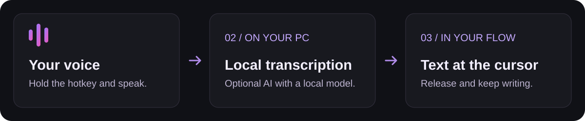

<p align="center">
  
</p>

<h1 align="center">Your next sentence starts with your voice.</h1>

<p align="center">
  <strong>Local voice dictation for Windows, built around Brazilian Portuguese.</strong><br>
  Hold a hotkey. Speak. Release. Your words appear where you are writing.<br>
  Free and open source. No account or subscription.
</p>

<p align="center">
  <a href="https://github.com/Daniellpego/Sussurro/actions/workflows/ci.yml"></a>
  <a href="https://github.com/Daniellpego/Sussurro/releases/latest"></a>
  
  <a href="LICENSE"></a>
</p>

<p align="center">
  <a href="https://github.com/Daniellpego/Sussurro/releases/latest/download/SussurroSetup-CPU.exe"><strong>↓ Download for Windows · CPU</strong></a> &nbsp;·&nbsp;
  <a href="https://github.com/Daniellpego/Sussurro/releases/latest/download/SussurroSetup-CUDA.exe"><strong>↓ NVIDIA version</strong></a><br>
  <sub>Ready-to-install apps. No Python, Git, or API key required.</sub>
</p>

<p align="center">
  <a href="#start-with-your-first-dictation">Get started</a> ·
  <a href="#a-small-app-in-your-workspace">See the app</a> ·
  <a href="#one-dictation-the-right-tone">Writing modes</a> ·
  <a href="#your-voice-stays-on-your-computer">Privacy</a> ·
  <a href="#before-your-first-dictation">FAQ</a> ·
  <a href="README.md">Português</a>
</p>

<p align="center"><sub>Original AI-generated cover artwork. The Portuguese tagline means “Your voice. Your text. Your computer.” App screenshots below use demonstration data.</sub></p>

---

## Less distance between thinking and writing.

A chat reply. An email you need to send. A project idea you want to capture before it slips away. Sussurro turns speech into text and attempts to paste it into the focused field, preserving the previous clipboard contents.

Speech recognition runs **on your computer**. Use optional writing modes with a **local Ollama model** to revise the result. Choose Raw dictation or a rewriting step before pasting.

<p align="center"></p>

**Say, in Portuguese:** “olá vírgula tudo bem ponto final nova linha obrigado”

With voice commands and capitalization enabled, the example becomes:

```text
Olá, tudo bem.
Obrigado
```

This illustrates formatting, not an accuracy guarantee. Recognition depends on the audio, model, and context. The interface and voice commands are in **Brazilian Portuguese**. Whisper supports other languages; set `language` in `%APPDATA%\Sussurro\config.toml` to a code such as `en`, or to `auto`.

## Start with your first dictation

### 1. Choose your installer

| Your computer | Download |
| :--- | :--- |
| No NVIDIA GPU, or you want to start on CPU | [**SussurroSetup-CPU.exe**](https://github.com/Daniellpego/Sussurro/releases/latest/download/SussurroSetup-CPU.exe) |
| NVIDIA GPU with CUDA support | [**SussurroSetup-CUDA.exe**](https://github.com/Daniellpego/Sussurro/releases/latest/download/SussurroSetup-CUDA.exe) |

Use Windows 10 **build 19041 or later**, or Windows 11, with a microphone. Start with **8 GB RAM** for CPU dictation; **16 GB** is recommended for AI writing modes. Larger models and recordings can require more. The CUDA installer bundles NVIDIA libraries and is a larger download. Processing speed depends on your hardware.

### 2. Set up once

Run the installer, open Sussurro, and follow the welcome steps: choose your microphone, download the speech model, and test the hotkey. Ollama and its writing model are **optional**. With local models downloaded, dictation works without internet.

<p align="center">
  
  
  
</p>

### 3. Hold. Speak. Release.

Open a text field, such as Notepad. Wait until the app is ready, hold <kbd>Ctrl</kbd> + <kbd>Win</kbd>, speak, and release. Check the result before sending. You can also configure a mouse button.

Sussurro stays in the **Windows system tray**, where you can change modes, pause dictation, or open Settings. If automatic pasting fails, follow the indicator and paste with <kbd>Ctrl</kbd> + <kbd>V</kbd>.

<details>
<summary><strong>Verify your download and understand the Windows warning</strong></summary>

Each release includes `checksums-sha256.txt`. In PowerShell:

```powershell
Get-FileHash .\SussurroSetup-CPU.exe -Algorithm SHA256
```

Compare with the matching entry from the **same release**. The hash checks integrity; it does not replace a publisher signature. The installers are not code-signed yet and may trigger SmartScreen. Check the download source before deciding to run them.

Installers are built by the [public release workflow](.github/workflows/release.yml). See [Releases](https://github.com/Daniellpego/Sussurro/releases) for all versions and notes.

</details>

## A small app in your workspace

The main window brings together mode, microphone, language, and recent dictations. Search the history to find and reuse up to **500 transcriptions**.

<p align="center">
  
  
</p>

<p align="center"><sub>App windows rendered by the project's screenshot script, with fictional text. Appearance may vary by version.</sub></p>

Light and dark themes, Windows startup, and optional feedback sounds help Sussurro fit your routine. Pasting attempts to restore your previous clipboard, including copied images and files.

## One dictation. The right tone.

Speech recognition turns your voice into text. The **mode** decides how to process it afterwards.

| When you want to… | Choose | What happens |
| :--- | :--- | :--- |
| Dictate without a rewriting step | **Raw** | No LLM; applies configured dictionary, punctuation, and voice commands. |
| Clean up hesitations and grammar | **Clean** | Local AI revision. |
| Prepare a professional message | **Email · Corporativo** | Rewrites as an email. |
| Organize your thoughts | **Bullets** | Summarizes into a list. |
| Prepare instructions or code | **Prompt · Code** | Formats and rewrites for the selected mode. |
| Write English from Portuguese speech | **Translate** | Translates PT-BR → English. |

AI modes require **Ollama and a downloaded model**. Edit their instructions or create your own. Document templates include **Laudo BI-RADS** and **Petição Inicial** for medical and legal drafts; review their contents before use.

<details>
<summary><strong>See the writing modes settings</strong></summary>

<p align="center"></p>

The Ollama client uses `127.0.0.1:11434`, but that does not guarantee that every model runs on your computer. Select a **local model** to keep rewriting offline. Cloud model tags can route text to remote processing through Ollama. Raw works without that service.

</details>

## Portuguese, with your own names and vocabulary

Add names, brands, and jargon to your **personal dictionary**. Macros recognize Portuguese spellings of acronyms, such as “esse tê efe” → **STF** and “ce pê éfe” → **CPF**.

| Say in Portuguese | The text receives |
| :--- | :--- |
| “vírgula”, “ponto final” | `,` and `.` |
| “dois pontos”, “ponto e vírgula” | `:` and `;` |
| “ponto de interrogação”, “ponto de exclamação” | `?` and `!` |
| “nova linha”, “novo parágrafo” | A line break or a new paragraph. |
| “abre aspas” … “fecha aspas” | `"…"` |
| “abre parênteses” … “fecha parênteses” | `(…)` |

Ordinary phrases such as “ganhei dois pontos no jogo” stay as text. Rules attempt to distinguish these contexts; check the result when a word could also be a command.

## Your voice stays on your computer

**Transcription does not require a cloud speech service.** Sussurro uses `faster-whisper` with `large-v3-turbo`. Optional rewriting uses Ollama and stays on your computer **when you choose a local model**.

| Step | Where it happens |
| :--- | :--- |
| Audio capture and speech recognition | Your computer, on CPU or NVIDIA GPU. |
| Optional rewriting and translation | On your computer with a local Ollama model; cloud models can send text for remote processing. |
| Settings, history, dictionary, and modes | `%APPDATA%\Sussurro`. |
| Model and tool downloads | Internet, during setup or when downloading another model. |
| Update check in the 0.1.3 source | Public GitHub API; disable in **Ajustes → Geral**. |

Once the models are ready, recognition and local rewriting can work **offline**. History is a local file: someone with access to your Windows account may be able to read it. Uninstalling preserves that data folder.

The editor accepts Ollama model names. Check the model's origin and your service configuration: [Ollama also offers cloud models](https://ollama.com/blog/cloud-models), including through its `localhost` API. A local address alone does not guarantee private text processing.

Where you paste matters too: text dictated into a third-party app or website becomes subject to that service's rules.

## Before your first dictation

<details>
<summary><strong>Do I need a GPU? How much memory does it use?</strong></summary>

No GPU is required: choose the CPU installer. The NVIDIA variant can accelerate recognition on compatible hardware and falls back to CPU if the GPU is unavailable. Memory and response time depend on the models, processor, GPU, and recording length. AI rewriting adds another model and processing step; try Raw to evaluate recognition on its own.

The tray offers **Pausar e liberar memória** (pause and free memory). Performance options are available in Settings. There is no promise of instant latency or fixed resource use on every computer.

</details>

<details>
<summary><strong>Will it work in every app?</strong></summary>

Sussurro attempts to paste into the focused field. Apps may restrict pasting, handle shortcuts differently, or run with higher privileges. In elevated windows, the text may remain on the clipboard for you to paste with **Ctrl + V**. Check the target field before speaking; compatibility is not universal.

</details>

<details>
<summary><strong>Does the microphone stay open while the app is ready?</strong></summary>

It can. While dictation is active, the app keeps the microphone prepared with a **300 ms** pre-buffer to preserve the start of speech. This is not continuous transcription: the hotkey controls dictation. Choose **Pausar e liberar memória** in the tray to stop capture.

</details>

<details>
<summary><strong>Do I need Ollama or an API key?</strong></summary>

**Raw** does not need Ollama. Clean, Email, Bullets, Translate, and other AI modes require the service and a model. With local models, no transcription API key or subscription is needed. Models use your own disk space and computing resources. Cloud models follow the provider's requirements and policies.

</details>

<details>
<summary><strong>Which version am I downloading? Why does a screen look different?</strong></summary>

The buttons point to the **latest published release**, **0.1.2** when this README was reviewed on October 15, 2026. The `main` source already prepares **0.1.3**, with a configurable keyboard hotkey, update notifications, and indicator changes. That does not automatically publish a new installer. Check the [CHANGELOG](CHANGELOG.md) and [release notes](https://github.com/Daniellpego/Sussurro/releases/latest) for what your download includes.

Interface images are versioned demonstration screenshots. The cover is conceptual artwork, not a performance measurement or an application screenshot.

</details>

## Inside, for people who want to build

**Python 3.11 or 3.12 · PySide6 · faster-whisper · optional Ollama.** Ready-made installers do not need this environment. These commands are for Windows development.

```powershell
git clone https://github.com/Daniellpego/Sussurro.git
cd Sussurro
py -3.11 -m venv .venv
.\.venv\Scripts\Activate.ps1
pip install -r requirements-dev.txt
# For NVIDIA, also run: pip install -r requirements-gpu.txt
python -m sussurro
```

Before submitting changes:

```powershell
ruff check sussurro scripts tests
python scripts/validate_all.py
```

The validator checks syntax, imports, and the `pytest` suite. Microphones, GPUs, global shortcuts, pasting, and installers also require [manual Windows validation](docs/TESTES-MANUAIS.md).

| Looking for… | Go to |
| :--- | :--- |
| Application flow and modules | [Architecture](docs/ARCHITECTURE.md) |
| CPU and CUDA installer builds | [Installer guide](installer/README.md) |
| Utilities and interface screenshots | [Scripts](scripts/README.md) |
| Project documents | [Documentation](docs/README.md) |
| Changes by version | [CHANGELOG](CHANGELOG.md) |

## Help fine-tune Sussurro

[Open an issue](https://github.com/Daniellpego/Sussurro/issues/new/choose) with the app version, CPU/CUDA variant, Windows version, and reproduction steps. Review logs before posting: they may contain local information. For code, see [Contributing](CONTRIBUTING.md). Report vulnerabilities through the [security policy](SECURITY.md).

Sussurro is distributed under the **[MIT license](LICENSE)**. Bundled components have their [own licenses](docs/THIRD_PARTY_LICENSES.md). Whisper, faster-whisper, and Ollama make local processing possible. [Research and visual provenance](docs/readme/REFERENCIAS.md) are documented in Portuguese; referenced projects do not endorse Sussurro.

---

<p align="center"><strong>Your voice belongs in your workflow.</strong><br><a href="https://github.com/Daniellpego/Sussurro/releases/latest">Download Sussurro and try your first dictation.</a></p>
