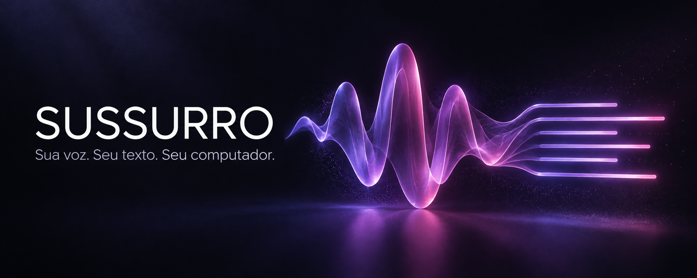
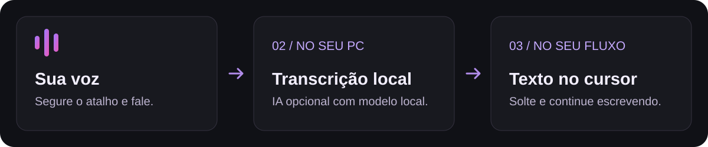
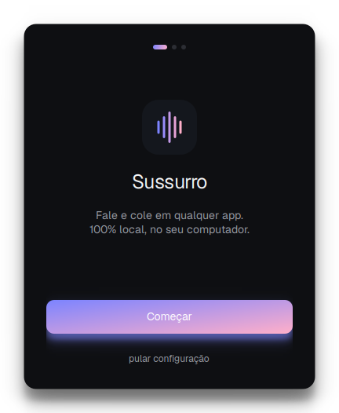
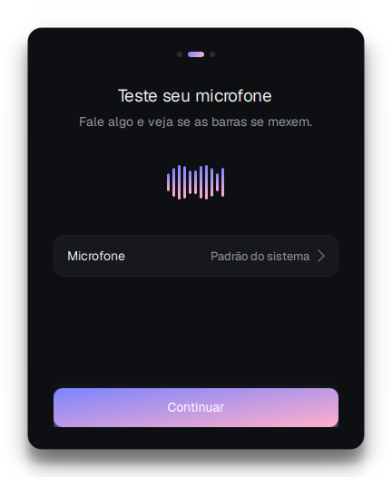
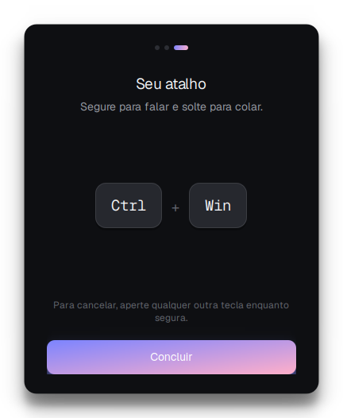
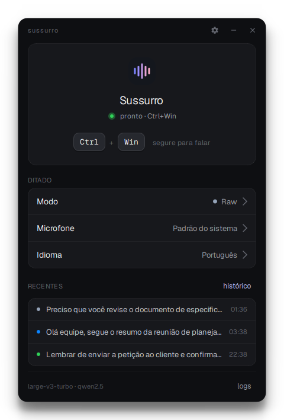
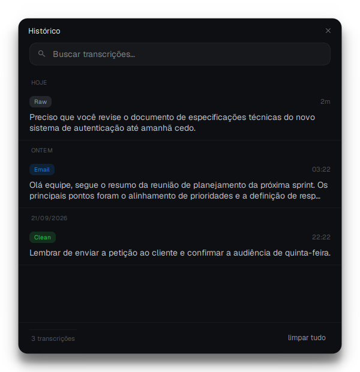
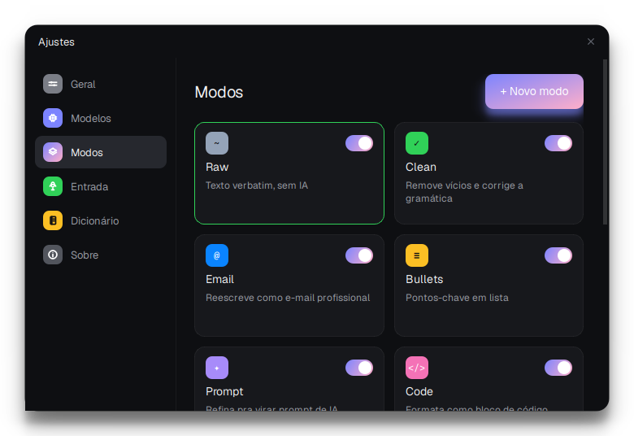

<p align="center">
  
</p>

<h1 align="center">Sua próxima frase começa com a sua voz.</h1>

<p align="center">
  <strong>Ditado local para Windows, feito para o português do Brasil.</strong><br>
  Segure um atalho. Fale. Solte. O texto aparece onde você está escrevendo.<br>
  Gratuito, com código aberto, sem conta e sem assinatura.
</p>

<p align="center">
  <a href="https://github.com/Daniellpego/Sussurro/actions/workflows/ci.yml"></a>
  <a href="https://github.com/Daniellpego/Sussurro/releases/latest"></a>
  
  <a href="LICENSE"></a>
</p>

<p align="center">
  <a href="https://github.com/Daniellpego/Sussurro/releases/latest/download/SussurroSetup-CPU.exe"><strong>↓ Baixar para Windows · CPU</strong></a> &nbsp;·&nbsp;
  <a href="https://github.com/Daniellpego/Sussurro/releases/latest/download/SussurroSetup-CUDA.exe"><strong>↓ Versão NVIDIA</strong></a><br>
  <sub>Instaladores prontos. Você não precisa de Python, Git ou chave de API.</sub>
</p>

<p align="center">
  <a href="#comece-pelo-seu-primeiro-ditado">Começar</a> ·
  <a href="#um-app-pequeno-no-seu-espaço-de-trabalho">Ver o app</a> ·
  <a href="#um-ditado-o-tom-certo">Modos</a> ·
  <a href="#sua-voz-fica-no-seu-computador">Privacidade</a> ·
  <a href="#perguntas-antes-do-primeiro-ditado">FAQ</a> ·
  <a href="README.en.md">English</a>
</p>

<p align="center"><sub>Arte de capa original gerada por IA. As capturas abaixo mostram a interface do app com dados de demonstração.</sub></p>

---

## Menos distância entre pensar e escrever.

Uma resposta no chat. Um e-mail que precisa sair. A ideia de um projeto que você quer registrar antes de esquecer. O Sussurro transforma sua fala em texto e tenta colá-lo no campo em foco, preservando o conteúdo anterior da área de transferência.

O reconhecimento de voz acontece **no seu computador**. Se quiser ajustar o texto, use os modos de revisão com um **modelo local do Ollama**. Você escolhe entre ditar com o modo Raw ou pedir uma reescrita antes de colar.

<p align="center">
  
</p>

**Você fala:** “olá vírgula tudo bem ponto final nova linha obrigado”

**O texto fica assim**, com os comandos de voz e a capitalização habilitados:

```text
Olá, tudo bem.
Obrigado
```

Exemplo ilustrativo de formatação. A precisão depende do áudio, do modelo e do contexto.

## Comece pelo seu primeiro ditado

### 1. Escolha o instalador

| Seu computador | Download |
| :--- | :--- |
| Sem GPU NVIDIA, ou quer começar pela CPU | [**SussurroSetup-CPU.exe**](https://github.com/Daniellpego/Sussurro/releases/latest/download/SussurroSetup-CPU.exe) |
| Com GPU NVIDIA compatível com CUDA | [**SussurroSetup-CUDA.exe**](https://github.com/Daniellpego/Sussurro/releases/latest/download/SussurroSetup-CUDA.exe) |

Use Windows 10 **build 19041 ou posterior**, ou Windows 11, com microfone. A recomendação inicial é **8 GB de RAM** para CPU e **16 GB** para os modos com IA; modelos e ditados maiores podem exigir mais. A variante CUDA inclui as bibliotecas NVIDIA e tem um download maior. O tempo de processamento varia com o hardware.

### 2. Prepare uma vez

Execute o instalador e abra o Sussurro. Na primeira execução, siga as boas-vindas: escolha o microfone, baixe o modelo de transcrição e teste o atalho. O Ollama e o modelo de revisão são **opcionais**. Com os modelos locais baixados, o ditado funciona sem internet.

<p align="center">
  
  
  
</p>

### 3. Segure. Fale. Solte.

Abra um campo de texto, por exemplo no Bloco de Notas. Aguarde o app ficar pronto, segure <kbd>Ctrl</kbd> + <kbd>Win</kbd>, fale uma frase e solte. Confira o resultado antes de enviar. Você também pode configurar um botão do mouse.

O app fica na **bandeja do Windows**. Por ali você troca o modo, pausa o ditado ou abre os Ajustes. Se a colagem automática não funcionar, siga o aviso do indicador e cole com <kbd>Ctrl</kbd> + <kbd>V</kbd>.

<details>
<summary><strong>Conferir o download e entender o aviso do Windows</strong></summary>

Cada release oferece `checksums-sha256.txt`. No PowerShell:

```powershell
Get-FileHash .\SussurroSetup-CPU.exe -Algorithm SHA256
```

Compare com a linha correspondente do arquivo de checksums da **mesma release**. O hash verifica a integridade; não substitui uma assinatura de editor. Os instaladores ainda não têm assinatura digital e podem receber um aviso do SmartScreen. Confira a origem do download antes de decidir executá-los.

Os instaladores são produzidos pelo [workflow público de release](.github/workflows/release.yml). Para todas as versões e notas, abra [Releases](https://github.com/Daniellpego/Sussurro/releases).

</details>

## Um app pequeno no seu espaço de trabalho

A janela principal reúne modo, microfone, idioma e ditados recentes. O histórico guarda até **500 transcrições**, com busca para encontrar e reutilizar o que você já disse.

<p align="center">
  
  
</p>

<p align="center"><sub>Janelas renderizadas pelo script de capturas do projeto; textos fictícios. A aparência pode variar entre versões.</sub></p>

Temas claro e escuro, início com o Windows e sons de confirmação opcionais ajudam o app a caber na sua rotina. A colagem procura restaurar a área de transferência, inclusive imagens e arquivos copiados.

## Um ditado. O tom certo.

O reconhecimento converte a voz em texto. O **modo** define o tratamento depois disso.

| Se você quer… | Escolha | Como funciona |
| :--- | :--- | :--- |
| Ditar sem uma etapa de reescrita | **Raw** | Sem LLM; aplica dicionário, pontuação e comandos de voz configurados. |
| Limpar hesitações e corrigir a escrita | **Clean** | Revisão com IA local. |
| Preparar uma mensagem profissional | **Email · Corporativo** | Reescrita com formato de e-mail. |
| Organizar as ideias | **Bullets** | Resumo em tópicos. |
| Preparar instruções ou código | **Prompt · Code** | Formatação e reescrita conforme o modo. |
| Escrever em inglês a partir do português | **Translate** | Tradução PT-BR → inglês. |

Os modos com IA precisam do **Ollama e de um modelo baixado**. Você pode editar as instruções e criar modos próprios. Há também modelos de rascunho para **Laudo BI-RADS** e **Petição Inicial**; revise o conteúdo antes de utilizá-lo.

<details>
<summary><strong>Ver o editor e a lista de modos</strong></summary>

<p align="center"></p>

O cliente do Ollama usa `127.0.0.1:11434`, mas isso não garante que todo modelo execute no computador. Para manter a revisão offline, selecione um **modelo local**. Tags de modelos cloud podem encaminhar o texto para processamento remoto pelo Ollama. O modo Raw funciona sem esse serviço.

</details>

## Português com os seus nomes e o seu jeito

Adicione termos ao **dicionário pessoal** para nomes, marcas e jargões. As macros reconhecem siglas ditas por extenso, como “esse tê efe” → **STF** e “ce pê éfe” → **CPF**.

| Você diz | O texto recebe |
| :--- | :--- |
| “vírgula”, “ponto final” | `,` e `.` |
| “dois pontos”, “ponto e vírgula” | `:` e `;` |
| “ponto de interrogação”, “ponto de exclamação” | `?` e `!` |
| “nova linha”, “novo parágrafo” | Quebra de linha ou de parágrafo. |
| “abre aspas” … “fecha aspas” | `"…"` |
| “abre parênteses” … “fecha parênteses” | `(…)` |

Frases comuns como “ganhei dois pontos no jogo” continuam como texto. As regras procuram distinguir esses contextos; confira o resultado quando uma palavra também puder ser um comando.

## Sua voz fica no seu computador

**A transcrição não depende de um serviço de reconhecimento na nuvem.** O Sussurro usa `faster-whisper` com o modelo `large-v3-turbo`. A revisão opcional usa o Ollama e permanece no computador **quando o modelo escolhido é local**.

| Etapa | Onde acontece |
| :--- | :--- |
| Captura e reconhecimento de voz | No computador, com CPU ou GPU NVIDIA. |
| Revisão e tradução opcionais | No computador com um modelo local do Ollama; modelos cloud podem enviar o texto para processamento remoto. |
| Configuração, histórico, dicionário e modos | Em `%APPDATA%\Sussurro`. |
| Downloads de modelos e ferramentas | Pela internet durante a preparação ou ao baixar novos modelos. |
| Consulta de versões, no código 0.1.3 | API pública do GitHub; pode ser desligada em **Ajustes → Geral**. |

Depois de preparados os modelos, o reconhecimento e a revisão local podem funcionar **offline**. O histórico é um arquivo local: quem tem acesso à sua conta do Windows pode ter acesso a esses dados. A desinstalação preserva essa pasta.

O editor permite informar modelos do Ollama. Confira a origem do modelo e a configuração do serviço: o [Ollama também oferece modelos cloud](https://ollama.com/blog/cloud-models), inclusive por uma API em `localhost`. O endereço local, sozinho, não garante processamento privado do texto.

O destino do texto também importa: ao ditar em um site ou aplicativo de terceiros, o texto passa a seguir as regras desse serviço.

## Perguntas antes do primeiro ditado

<details>
<summary><strong>Preciso de placa de vídeo? Vai consumir muita memória?</strong></summary>

Não é obrigatório ter GPU: use o instalador CPU. A versão NVIDIA pode acelerar o reconhecimento em hardware compatível e volta para CPU se a GPU não estiver disponível. Memória e tempo de resposta dependem do modelo, do processador, da GPU e da duração do ditado. A revisão com IA adiciona outra etapa e outro modelo; comece pelo Raw para avaliar o reconhecimento sozinho.

O menu da bandeja oferece **Pausar e liberar memória**. Os Ajustes incluem opções de desempenho. Não há promessa de latência instantânea ou consumo fixo para todos os computadores.

</details>

<details>
<summary><strong>Funciona em qualquer aplicativo?</strong></summary>

O Sussurro tenta colar no campo em foco. Aplicativos podem restringir a colagem, tratar atalhos de formas diferentes ou estar executando com privilégios superiores. Em janelas elevadas, o resultado pode ficar na área de transferência para você colar com **Ctrl + V**. Verifique o campo e a janela antes de falar; a compatibilidade não é universal.

</details>

<details>
<summary><strong>O microfone fica aberto enquanto o app está pronto?</strong></summary>

Pode ficar. Quando o ditado está ativo, o app mantém o microfone preparado com um pré-buffer de **300 ms** para preservar o início da fala. Isso não significa transcrição contínua: o atalho controla o ditado. Use **Pausar e liberar memória** na bandeja quando quiser interromper a captura.

</details>

<details>
<summary><strong>Preciso do Ollama? E de uma chave de API?</strong></summary>

O modo **Raw** dispensa o Ollama. Clean, Email, Bullets, Translate e os demais modos de IA precisam do serviço e de um modelo. Com modelos locais, não é necessária chave de API de transcrição nem assinatura. Baixar modelos e usá-los ocupa disco e recursos do seu computador. Modelos cloud seguem os requisitos e as políticas do provedor.

</details>

<details>
<summary><strong>Qual versão estou baixando? Por que uma tela parece diferente?</strong></summary>

Os botões apontam para a **última release publicada**, que, na revisão deste README em 15/10/2026, é a **0.1.2**. O código `main` já prepara a **0.1.3**, com atalho de teclado configurável, aviso de atualizações e mudanças no indicador. Isso não publica um instalador novo automaticamente. Confira o [CHANGELOG](CHANGELOG.md) e as [notas da versão](https://github.com/Daniellpego/Sussurro/releases/latest) para saber o que seu download inclui.

As imagens da interface são capturas de demonstração versionadas no projeto. A capa é arte conceitual; não representa uma medição de desempenho ou uma captura da aplicação.

</details>

## Por dentro, para quem quer construir

**Python 3.11 ou 3.12 · PySide6 · faster-whisper · Ollama opcional.** O instalador pronto dispensa este ambiente; os comandos abaixo são para desenvolvimento no Windows.

```powershell
git clone https://github.com/Daniellpego/Sussurro.git
cd Sussurro
py -3.11 -m venv .venv
.\.venv\Scripts\Activate.ps1
pip install -r requirements-dev.txt
# Para NVIDIA, instale também: pip install -r requirements-gpu.txt
python -m sussurro
```

Antes de enviar mudanças:

```powershell
ruff check sussurro scripts tests
python scripts/validate_all.py
```

O validador confere sintaxe e imports e executa a suíte `pytest`. Microfone, GPU, atalhos, colagem e instaladores também exigem [validação manual no Windows](docs/TESTES-MANUAIS.md).

| Quer encontrar… | Caminho |
| :--- | :--- |
| Fluxo e módulos da aplicação | [Arquitetura](docs/ARCHITECTURE.md) |
| Build dos instaladores CPU e CUDA | [Guia do instalador](installer/README.md) |
| Utilitários e capturas de interface | [Scripts](scripts/README.md) |
| Contexto e documentos do projeto | [Documentação](docs/README.md) |
| O que mudou em cada versão | [CHANGELOG](CHANGELOG.md) |

## Ajude a afinar o Sussurro

[Abra uma issue](https://github.com/Daniellpego/Sussurro/issues/new/choose) com a versão do app, CPU/CUDA, Windows e passos para reproduzir. Revise logs antes de publicá-los: eles podem conter informações locais. Para código, veja o [guia de contribuição](CONTRIBUTING.md). Vulnerabilidades seguem a [política de segurança](SECURITY.md).

O Sussurro é distribuído sob a **[licença MIT](LICENSE)**. Os componentes incluídos têm suas [próprias licenças](docs/THIRD_PARTY_LICENSES.md). Whisper, faster-whisper e Ollama tornam o processamento local possível. A [pesquisa e a origem dos visuais](docs/readme/REFERENCIAS.md) estão documentadas; não há endosso dos projetos consultados.

---

<p align="center"><strong>Sua voz merece um lugar no seu fluxo.</strong><br><a href="https://github.com/Daniellpego/Sussurro/releases/latest">Baixe o Sussurro e experimente seu primeiro ditado.</a></p>
